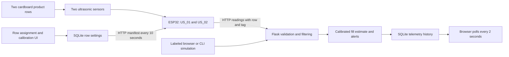

# Architecture

The supported application is a single Flask process with a same-origin browser UI
and SQLite persistence. The legacy Streamlit / MQTT modules are retained for reference.
One classic ESP32 DevKit controls two sequentially triggered HC-SR04 channels.

Physical shelf RACK_01 has rows 1 and 2. For API compatibility their channel IDs are
SHELF_01 and SHELF_02. Each row stores one product name/tag, assigned device/sensor,
30 cm length, calibration and threshold. Printed tags are assigned by the operator;
there is no RFID reader or automatic product recognition. ESP32 fetches the manifest,
learns product tags, then sends each fixed sensor's row and tag with the reading.

The app validates channel, device and supplied sensor/tag identity. It filters five
valid samples independently per row, resets on faults, source changes, outages,
settings changes and restart. Invalid echoes never imply empty. A 60-second health
window replaces stale stock with OFFLINE and removes the displayed current fill.
Alerts deduplicate, update on severity changes, and clear after fresh stock recovery.
Settings changes clear old-assignment alerts and retain historical telemetry.

The cardboard model uses guided product lanes with a flat sliding follower behind
products and a rear sensor. The operator moves the follower against remaining stock.
Distance increases as stock is removed. Fill is a linear estimate between measured
full and empty stops, not an exact count. Demo calibration is explicitly marked and
must be replaced before a physical demonstration. A vertical stack is an alternative
only after changing the sensor mount and remeasuring calibration.

SQLite migration retains existing names/calibration/history and retires the old third
channel. Legacy assignments receive generated tags and demo/unverified calibration
labels. New rows seed from config.yaml. Product/settings changes persist across restart.
API-key protection is optional for writes; reads are visible on the LAN. One backend
process is supported because the filter is memory-local. Public deployment requires
an appropriate hosting, authentication and transport design beyond this local prototype.
