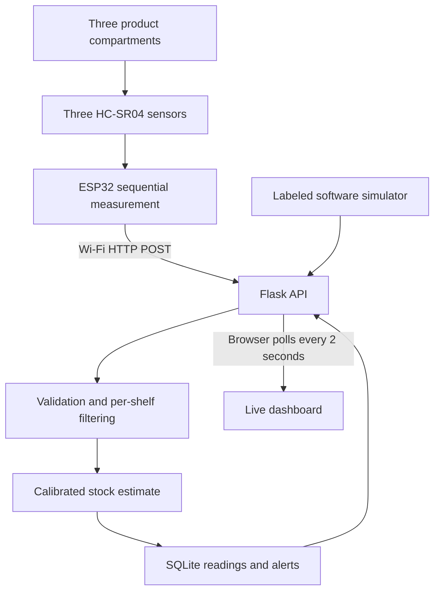

# Architecture

The ESP32 sequentially measures three shelves and POSTs one JSON reading per shelf
approximately every two seconds. A laptop on the same Wi-Fi hosts a Flask API and
browser dashboard. SQLite stores readings, alerts and per-shelf product calibration.
No MQTT broker or cloud account is needed for the default path.

Configured shelves appear even without readings. Calibration lives in SQLite after
initial product/device seeding from config.yaml. Filters are independent per shelf;
sensor faults clear their window, and hardware/simulator switches reset it.
Do not run simulator and physical device together for the same shelf.

The API validates finite distances (2–400 cm or -1 timeout), checks assigned devices,
and uses server UTC timestamps when the ESP32 omits time. Old numeric millis()
timestamps are rejected. Latest readings use increasing database IDs to avoid
multiple rows per shelf when timestamps match.

Stock levels are a linear estimate between full and empty distances for a controlled
stack. Never treat a missed echo as empty. Health status is derived from a 60-second
freshness window; stale values lose their displayed fill estimate. Pending stock
alerts survive faults/offline periods until a valid stock recovery arrives.
Calibrating preserves history and waits for a new reading.

One backend process is supported; the moving-average filter is memory-local and
resets on restart. API-key authentication is optional for write endpoints. Read
endpoints are unauthenticated on the LAN. Flask's development server is suitable
for the semester demo; public deployment would require proper hosting and TLS.
