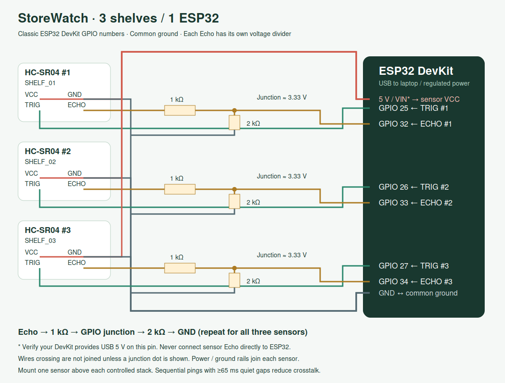

# Three-shelf test rig

## Parts and planning budget (India)
These are **planning allowances**, not a seller quotation; shipping is additional.
The HC-SR04 vendor listing checked on 11 October 2026 was ₹79 per module.
Choose a classic ESP32-WROOM-32 DevKit / ESP32 Dev Module with GPIOs listed below,
not an ESP32-C3 with a different pinout.

| Component | Quantity | Budget allowance |
|---|---:|---:|
| ESP32 DevKit (classic ESP32, USB) | 1 | ₹350–550 |
| HC-SR04 5 V ultrasonic module | 3 | ₹237–300 |
| 1 kΩ resistor, 1% preferred | 3 | included below |
| 2 kΩ resistor, 1% preferred | 3 | ₹20–40 for resistor set |
| Breadboard + jumper wires | 1 set | ₹120–200 |
| Data-capable USB cable | 1 | ₹50–100, or reuse |
| Cardboard compartments + sensor mounts | 3 | ₹0–100, or reuse |
| Existing laptop, Wi-Fi router/hotspot, USB power | existing | ₹0 |
| **Total planning range** | | **₹777–1,290** |

No paid services or broker are required. Sensors draw about 15 mA each at 5 V;
provide a stable USB supply and short leads. Board power pin labels differ: check
that your DevKit's 5 V/VIN pin provides USB 5 V before using it as the sensor supply.
Otherwise use a separate regulated 5 V sensor supply with **common ground**. Never
feed 5 V into the ESP32 3V3 pin; avoid tying two independent 5 V supplies together.

## Pin mapping (matches firmware)

| Shelf / sensor | Product (editable) | TRIG → ESP32 | ECHO → divider → ESP32 |
|---|---|---|---|
| SHELF_01 / HC-SR04 #1 | Coca-Cola | GPIO 25 | GPIO 32 |
| SHELF_02 / HC-SR04 #2 | Biscuits | GPIO 26 | GPIO 33 |
| SHELF_03 / HC-SR04 #3 | Shampoo | GPIO 27 | GPIO 34 |

All three VCC pins connect to regulated **5 V**. All three GND pins connect to ESP32
GND. The pins are GPIO numbers, not header positions. GPIO34 is input-only, which
is suitable for Echo. This map is for the classic ESP32 DevKit.

For **each** sensor, wire this divider:

1. Sensor ECHO → **1 kΩ resistor** → junction.
2. Junction → assigned ESP32 Echo GPIO.
3. Junction → **2 kΩ resistor** → common GND.

The nominal junction voltage is `5 × 2/(1+2) = 3.33 V`.
**A standard HC-SR04 Echo must not connect directly to an ESP32 GPIO.**
TRIG connects directly from the assigned 3.3 V ESP32 output; test your sensor clone
accepts that trigger level. If it does not, use a suitable 3.3→5 V logic buffer for
TRIG; retain Echo dividers. Use a common ground in every case.

## Mounting that makes the measurements meaningful

Build three small rigid compartments, each with one assigned product type. For a
repeatable semester demonstration, use identical flat boxes / packets stacked
vertically in each compartment. Mount each sensor on the ceiling, pointing down
at the flat top of its stack. Label the compartments with their shelf IDs.

- Keep **at least 2 cm** between transducers and even the fullest stack; prefer 5 cm.
- Use a rigid shelf floor so an empty compartment still returns an echo.
- Full stack target: around 5 cm sensor-to-product distance; empty compartment:
  around 30 cm sensor-to-floor distance. These are demo dimensions, not universal calibration.
- Keep the stack centered and fill the beam with a reasonably flat target.
- Separate compartments with dividers; aim sensors so they do not face each other.
- Soft bags, angled surfaces, shelf edges and tiny targets can cause missed echoes.
- Sensors are triggered sequentially with a 65 ms quiet interval. This reduces,
  but does not eliminate, crosstalk; verify the physical rig.

A single overhead sensor cannot infer the number of bottles arranged side by
side: removing one bottle may not change nearest-surface height. For realistic
store shelves, dedicate sensors to constrained lanes or adopt weight sensing later.
The current application displays **fill estimate**, never a claimed exact item count.

## Calibration, per shelf
1. Stop the simulator. Check serial telemetry says HTTP 201.
2. Measure actual sensor-to-floor distance with a ruler. Read the dashboard with
   an empty compartment for 10–20 seconds and compare. Record `empty_cm`.
3. Add the maximum repeatable stack. Record the sensor-to-top distance as `full_cm`.
4. Open Assign / calibrate, enter the product and both distances; set low threshold,
   initially 25%. Settings persist in SQLite and history stays intact.
5. Try roughly 100%, 50%, 25% and 0% stack heights. Record ruler distances and measured
   values in docs/testing.md. Adjust mounting and calibration if inconsistent.
6. Remove items and wait for up to five reporting cycles for the moving average
   to settle (roughly 10 seconds on a healthy link).

`fill% = clamp(100 × (empty_cm − filtered_distance) / (empty_cm − full_cm), 0, 100)`

This assumes stack height is proportional to remaining stock. It is a demo model.
At ≤5%: EMPTY; up to configured low threshold: LOW_STOCK; ≥90%: FULL;
otherwise NORMAL. No echo (-1) gives UNKNOWN; no recent reading gives OFFLINE.

## Reference sources
- HC-SR04 datasheet: https://cdn.sparkfun.com/datasheets/Sensors/Proximity/HCSR04.pdf
  (5 V supply, 2–400 cm range, 10 µs trigger, >60 ms measurement cycle).
- ESP32 electrical limits: https://documentation.espressif.com/esp32_datasheet_en.html
- Indicative HC-SR04 listing: https://robu.in/product-category/best-prices/

The three sensors, divider values, pin assignment and stack model are the design
choices for this prototype. Budget lines other than the sensor listing are allowances.
