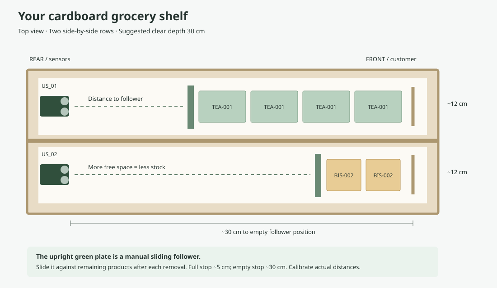
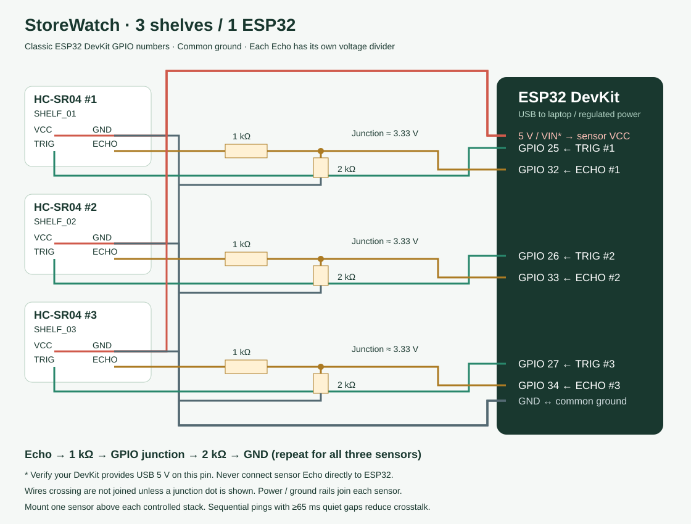

# Two-row cardboard grocery shelf: final hardware setup

## What you are building

One physical shelf (RACK_01), with two side-by-side product rows, each **30 cm deep**.
The API retains SHELF_01 and SHELF_02 as row channel IDs for backward compatibility.
Each row has one HC-SR04; a classic ESP32-WROOM-32 DevKit reads both sensors.
A laptop on the same Wi-Fi runs Flask, SQLite and the dashboard. No broker or cloud is needed.

Product tags are printed labels/SKUs such as TEA-001 and BIS-002. Type them in
Assign / calibrate, or use a USB barcode scanner attached to the laptop as a keyboard.
**No RFID reader is included.** Ultrasonic sensors cannot identify products or detect
that the wrong product was placed in a row. The ESP32 learns each row's assigned tag
from the backend manifest and includes it in telemetry; reassignment needs no reflash.

## Required hardware specifications

| Part | Qty | Required specification / purpose |
|---|---:|---|
| ESP32 DevKit | 1 | Classic ESP32-WROOM-32, esp32dev / ESP32 Dev Module, USB, accessible GPIO25/26/32/33. Do not substitute ESP32-C3/S3 without changing pin mapping. |
| HC-SR04 | 2 | Standard 4-pin VCC/TRIG/ECHO/GND, 5 V supply, nominal 2–400 cm range, 10 µs trigger. One per row. |
| Resistor | 2 | 1 kΩ, preferably 1%, 1/4 W; upper resistor in each Echo divider. |
| Resistor | 2 | 2 kΩ, preferably 1%, 1/4 W; lower resistor in each Echo divider. |
| Breadboard | 1 | At least 400 tie points for controller and two divider circuits. |
| Jumper wires | 16–20 | Male/male and male/female as required, short runs under about 30 cm preferred. |
| USB data cable | 1 | Match DevKit connector (Micro USB or USB-C); a charge-only cable cannot flash. |
| USB supply | 1 | Regulated 5 V, 1 A or more; laptop USB is suitable if stable. |
| Cardboard / foam board | As needed | Rigid double-layer base, rear wall, side guides, central divider and two sliding followers. |
| Flat dummy products | 2 sets | Small identical cartons per row; different printed tags for each set. |
| Tape / glue / ruler | 1 set | Secure mounting, measuring and labels. Keep glue away from transducers. |
| Laptop + Wi-Fi | Existing | Python 3.10+, browser, PlatformIO; shared 2.4 GHz Wi-Fi without client isolation. |

No load cell, RFID reader, display or Raspberry Pi is required. Select compatible
parts from your supplier; these are specifications, not a price quotation.

## Cardboard dimensions and measurement geometry



Suggested clear internal dimensions: **30 cm deep × 25 cm wide × 12–15 cm high**.
Use two ~12 cm wide lanes with a central divider. Sensor-to-follower travel is
approximately 5 cm at full and 30 cm at empty, leaving ~25 cm usable product depth.
The sensor face defines zero; include its mounting recess when measuring the base.

Cut a base about 32 × 27 cm, rear wall about 27 × 15 cm, two side walls and a central
divider about 30 × 12 cm. Adjust for cardboard thickness to obtain the clear dimensions.
Make two broad, upright follower plates about 10 × 10 cm, with folded feet or runners.
Keep them square to the sensor beam and able to slide without tilting. Add a 5 cm stop.

**Top view, for each row:**

    REAR / sensor                                       FRONT / customer
    [HC-SR04] ---> free distance ---> [flat follower][products][front stop]
    full: follower at ~5 cm                     empty: follower at ~30 cm

Mount each sensor at the rear, around 5–6 cm above the base, facing horizontally
along its lane. Keep the sensor beam clear of side walls, floor and divider.
Products stay toward the front; the follower stays directly behind them. As you
remove products from the front, slide the follower forward until it touches the
remaining products. When empty it reaches the front stop; when fully packed it is
near the rear stop. This manual follower is intentional for the simple prototype.
An automatic spring follower can be added later but must use the same geometry.

A stable flat target is essential: packets and bottles alone may give missed or
unchanging echoes. These small cardboard targets are below the datasheet's large
flat-target test conditions, so bench-test alignment and repeatability before the
presentation. If a lane is unreliable, widen the follower/row or use a vertical stack
with the sensor pointing down; remeasure full and empty distances accordingly.
The app estimates occupied depth/height, not exact item counts.

## Exact connection map



| Physical location | Row API ID | Sensor ID | TRIG GPIO | ECHO GPIO through divider |
|---|---|---|---:|---:|
| Left row / Row 1 | SHELF_01 | US_01 | 25 | 32 |
| Right row / Row 2 | SHELF_02 | US_02 | 26 | 33 |

For both sensors: VCC → regulated 5 V; GND → common GND. GPIO numbers are chip
GPIO numbers, not header positions. Confirm labels on your specific DevKit.
If USB powers your DevKit, use its 5 V/VIN pin **only after confirming it exposes USB
5 V**. Otherwise use a separate regulated sensor supply, joining grounds, without
tying independent 5 V supplies together. Never feed sensor 5 V into the 3V3 pin.

For **each Echo** use its own divider:

    HC-SR04 ECHO --- 1 kΩ ---+--- ESP32 input (GPIO32 or GPIO33)
                            |
                           2 kΩ
                            |
                           GND

The ideal divider output is 5 × 2/(1+2) = 3.33 V. Check the actual voltage before
connecting the input, keep it within the ESP32's specified limits, and use a proper
5 V-to-3.3 V level shifter instead if supply/tolerances make it too high.
**Never connect HC-SR04 Echo directly to an ESP32 GPIO.**
TRIG connects directly to GPIO25/26. Verify your HC-SR04 clone accepts a 3.3 V
trigger; if not, add a suitable 3.3 V-to-5 V logic buffer for TRIG.

## Final setup, from an empty desk

1. Build the two lanes and followers. Label the left lane SHELF_01 / US_01 and the
   right lane SHELF_02 / US_02. Attach a printed tag to each product group.
2. With USB unplugged, wire the breadboard, both sensors and both Echo dividers.
   Check common ground, resistor junctions, supply pins and no shorts before powering.
3. From the repository root, create the Python environment and start the server:

   ```powershell
   python -m venv .venv
   .venv\Scripts\python.exe -m pip install -r requirements-device.txt
   .venv\Scripts\python.exe -m backend.app
   ```

4. Open http://localhost:5000. First test via the browser Test bench: choose a row,
   Use demo calibration, then send distances near 5, 26 and 30 cm. Repeat readings
   to settle the five-sample moving average. Test the missing-echo checkbox.
5. Stop sending simulated readings before connecting the ESP32. Join laptop and
   ESP32 to the same 2.4 GHz network. Find laptop IPv4 with `ipconfig`; keep that IP
   stable for the demonstration. Guest networks may block device-to-laptop traffic.
6. Install VS Code with PlatformIO IDE, open `firmware/esp32`. Copy
   `secrets.example.h` to `secrets.h` (ignored by Git). Set WIFI_SSID, WIFI_PASSWORD
   and BACKEND_URL to `http://LAPTOP_IPV4:5000/api/readings`. Do not use localhost.
   Set API_KEY only if STOREWATCH_API_KEY is enabled on the server.
7. Build, upload and open serial monitor at 115200 baud. PlatformIO installs the
   pinned ESP32 platform and ArduinoJson library. Select the USB COM port. If upload
   stalls, hold BOOT at connection and release once uploading starts.
8. Allow Python inbound TCP 5000 on your private LAN if Windows asks. Check the
   dashboard/health endpoint using the laptop IPv4 from another LAN device.
9. In Assign / calibrate, enter product tag and name for each row. Use the actual
   measured full and empty distances and choose **Measured on physical shelf**.
   The ESP32 polls `/api/devices/ESP32_01/config` at startup and every 10 seconds.
   Serial prints `US_01 -> SHELF_01 / TAG / Product`; telemetry should return HTTP 201.
   A changed tag rejects old telemetry until the board refreshes its assignment.
10. Test each row independently: full, half, low, empty, no echo, then unplug USB.
    The dashboard should show FULL/NORMAL/LOW_STOCK/EMPTY, a sensor fault for no echo,
    and OFFLINE after 60 seconds without data. Reconnect and verify recovery.

Optional CLI firmware build (from the repository root):

```powershell
.venv\Scripts\python.exe -m pip install platformio
.venv\Scripts\python.exe -m platformio run -d firmware/esp32
.venv\Scripts\python.exe -m platformio run -d firmware/esp32 --target upload
.venv\Scripts\python.exe -m platformio device monitor -b 115200
```

## Calibration and acceptance checks

Measure sensor-face-to-follower distance at the full and empty stops with a ruler.
Compare the raw readings over 10–20 seconds; adjust alignment before saving.
Do not assume 5 and 30 cm are correct for the finished rig.

`fill% = clamp(100 × (empty_cm − filtered_distance) / (empty_cm − full_cm), 0, 100)`

At ≤5%: EMPTY; up to the row's low threshold (default 25%): LOW_STOCK;
≥90%: FULL; otherwise NORMAL. Five recent valid samples are averaged. A -1 no-echo
value is UNKNOWN and never means empty; it clears the filter and keeps stock alerts.
Sensors ping sequentially with at least 65 ms quiet time. Actual reporting interval
can exceed 2 seconds during slow HTTP responses.

| Test | Expected evidence |
|---|---|
| Assign a new tag to Row 1 | Database persists it, manifest changes, ESP32 logs the tag; Row 2 stays unchanged. |
| Full / half / empty follower positions | Plausible fill estimates after five samples; record ruler and sensor values. |
| Low and empty repeated | One active alert per row; severity updates; fresh recovery clears alert. |
| No echo | Sensor fault with no fill estimate; existing refill alert is retained. |
| Disconnect Wi-Fi/USB | OFFLINE after 60 seconds; no stale stock presented as current. |
| Restart backend | Assignments and history persist; first new reading starts a new filter window. |
| Browser simulation | SIMULATED DATA and Demo calibration are visible; hardware channel count stays zero. |

Physical hardware performance must be verified on the assembled rig. Firmware
compilation and API simulation cannot establish actual sensor accuracy.

## Primary references

- [HC-SR04 datasheet](https://cdn.sparkfun.com/datasheets/Sensors/Proximity/HCSR04.pdf): supply, range, trigger and measurement interval.
- [ESP32 datasheet](https://documentation.espressif.com/esp32_datasheet_en.html): GPIO and electrical limits.
- [ArduinoJson v7 documentation](https://arduinojson.org/v7/api/jsondocument/): firmware JSON configuration and telemetry.
